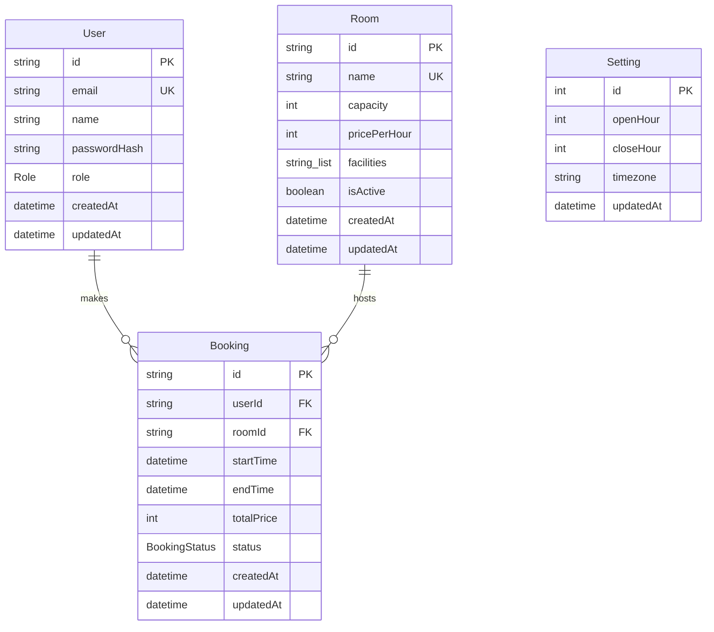

# Loka

A room booking API for studios, meeting rooms, and shared spaces. Users can browse rooms, check hourly availability, and reserve time slots. Admins manage rooms, opening hours, and every reservation.

> **Status:** backend is implemented and tested. The Vue frontend, full Docker setup, and database seed are still in progress (see [Roadmap](#roadmap)).

## Tech stack

| Layer | Technology |
| --- | --- |
| Runtime | Node.js 24, TypeScript |
| API | Express 5 |
| ORM | Prisma 7 (driver adapter `@prisma/adapter-pg`) |
| Database | PostgreSQL 17 (Docker) |
| Validation | Zod 4 |
| Auth | JWT (`jsonwebtoken`) + bcrypt |
| Date/time | `date-fns` + `date-fns-tz` |

## Features

### Implemented

- [x] JWT authentication: register, login, current user
- [x] Role-based access control (`USER`, `ADMIN`)
- [x] Room CRUD with soft delete (`isActive`)
- [x] Global operating hours + IANA timezone setting
- [x] Hourly availability slots (`AVAILABLE`, `BOOKED`, `PAST`)
- [x] Booking with server-side price calculation
- [x] Anti double-booking using a transaction + row-level lock (`409 Conflict`)
- [x] Booking history, cancellation window (2 hours), admin status updates
- [x] Zod validation middleware for `body`, `query`, and `params`
- [x] Consistent JSON error responses
- [x] PostgreSQL 17 via Docker Compose

### Planned

- [ ] Vue 3 + Vite + TypeScript frontend
- [ ] Pinia stores, booking calendar, admin dashboard
- [ ] Dockerfiles for backend and frontend, single root `docker-compose.yml`
- [ ] `prisma/seed.ts` with demo admin/user accounts and sample rooms

## Project structure

```
loka/
├── backend/
│   ├── prisma/
│   │   ├── schema.prisma
│   │   └── migrations/
│   ├── src/
│   │   ├── config/env.ts          # validated environment variables
│   │   ├── lib/                   # prisma, jwt, errors, time helpers
│   │   ├── middlewares/           # auth, validation, error handling
│   │   ├── modules/
│   │   │   ├── auth/
│   │   │   ├── rooms/
│   │   │   ├── settings/
│   │   │   ├── availability/
│   │   │   └── bookings/
│   │   ├── types/express.d.ts
│   │   ├── app.ts
│   │   └── server.ts
│   ├── prisma.config.ts
│   └── .env.example
├── postgresql_17/
│   └── docker-compose.yml         # local PostgreSQL only
└── .gitignore
```

## Prerequisites

- Node.js 24+
- pnpm 10+
- Docker + Docker Compose

## Quick start

### 1. Start PostgreSQL

```bash
cd postgresql_17
docker compose up -d
```

This starts a container named `loka_db` with:
- database: `loka_db`
- user: `felicia`
- password: `loka_app_pass`
- port: `127.0.0.1:5432`

Data is stored in the named Docker volume `postgresql_17_pgdata`, so it survives container restarts.

### 2. Configure the backend

```bash
cd backend
cp .env.example .env
```

Edit `.env` if needed. `JWT_SECRET` must be at least 32 characters.

### 3. Install, migrate, and run

```bash
pnpm install
pnpm db:migrate        # applies migrations and generates the Prisma client
pnpm dev               # http://localhost:4000
```

Check that everything is alive:

```bash
curl http://localhost:4000/api/health
# {"status":"ok","db":"connected","timestamp":"..."}
```

## Environment variables

| Variable | Required | Default | Description |
| --- | --- | --- | --- |
| `DATABASE_URL` | yes | — | PostgreSQL connection string |
| `JWT_SECRET` | yes | — | Signing secret, at least 32 characters |
| `PORT` | no | `4000` | HTTP port |
| `NODE_ENV` | no | `development` | `development`, `test`, or `production` |
| `CORS_ORIGIN` | no | `http://localhost:5173` | Allowed frontend origin |

Environment variables are validated at startup in `src/config/env.ts`. The app refuses to start if something is missing or invalid.

## Database

### ERD



### Enums

- `Role`: `USER`, `ADMIN`
- `BookingStatus`: `CONFIRMED`, `CANCELLED`, `COMPLETED`

### Migrations

```bash
pnpm db:migrate      # create + apply a migration in development
pnpm db:deploy       # apply existing migrations (production/CI)
pnpm db:generate     # regenerate the Prisma client
pnpm db:studio       # open Prisma Studio at http://localhost:5555
```

### Create the first admin

Registration always creates a `USER`. Until the seed script exists, promote a user manually:

```bash
docker exec loka_db psql -U felicia -d loka_db \
  -c "UPDATE \"User\" SET role = 'ADMIN' WHERE email = 'you@example.com';"
```

Log in again afterwards: the role is embedded in the JWT, so old tokens still say `USER`.

## API reference

Base URL: `http://localhost:4000/api`

Protected endpoints expect:

```
Authorization: Bearer <token>
```

### Health

| Method | Path | Access |
| --- | --- | --- |
| GET | `/api/health` | Public |

### Auth

| Method | Path | Access | Body |
| --- | --- | --- | --- |
| POST | `/api/auth/register` | Public | `{ "email", "name", "password" }` |
| POST | `/api/auth/login` | Public | `{ "email", "password" }` |
| GET | `/api/auth/me` | User | — |

```bash
curl -X POST http://localhost:4000/api/auth/register \
  -H "Content-Type: application/json" \
  -d '{"email":"user@loka.test","name":"Demo User","password":"password123"}'
```

### Rooms

| Method | Path | Access | Description |
| --- | --- | --- | --- |
| GET | `/api/rooms` | Public | Active rooms only |
| GET | `/api/rooms/:id` | Public | Room detail |
| GET | `/api/rooms/all` | Admin | All rooms, including inactive |
| POST | `/api/rooms` | Admin | Create a room |
| PATCH | `/api/rooms/:id` | Admin | Update fields |
| DELETE | `/api/rooms/:id` | Admin | Soft delete (`isActive = false`) |

Create body:

```json
{
  "name": "Studio A",
  "capacity": 6,
  "pricePerHour": 75000,
  "facilities": ["TV", "Whiteboard", "AC"]
}
```

### Settings

| Method | Path | Access | Description |
| --- | --- | --- | --- |
| GET | `/api/settings` | Public | Current operating hours |
| PUT | `/api/settings` | Admin | Replace operating hours |

```json
{
  "openHour": 9,
  "closeHour": 21,
  "timezone": "Asia/Jakarta"
}
```

`closeHour` must be greater than `openHour`. `timezone` must be a valid IANA timezone.

### Availability

| Method | Path | Access |
| --- | --- | --- |
| GET | `/api/rooms/:id/availability?date=YYYY-MM-DD` | Public |

Example response:

```json
{
  "room": { "id": "...", "name": "Studio A", "capacity": 6, "pricePerHour": 75000 },
  "date": "2026-11-18",
  "timezone": "Asia/Jakarta",
  "openHour": 9,
  "closeHour": 21,
  "slots": [
    {
      "hour": 9,
      "startTime": "2026-11-18T02:00:00.000Z",
      "endTime": "2026-11-18T03:00:00.000Z",
      "label": "09:00 - 10:00",
      "status": "AVAILABLE"
    }
  ]
}
```

Slot status:

- `AVAILABLE` — free and in the future
- `BOOKED` — overlaps a `CONFIRMED` booking
- `PAST` — already started (in-progress slots included)

### Bookings

| Method | Path | Access | Description |
| --- | --- | --- | --- |
| POST | `/api/bookings` | User | Create a booking |
| GET | `/api/bookings/me` | User | Own bookings (`?status=` optional) |
| GET | `/api/bookings/:id` | Owner / Admin | Booking detail |
| GET | `/api/bookings` | Admin | All bookings (`?status=` optional) |
| PATCH | `/api/bookings/:id/cancel` | Owner / Admin | Cancel a booking |
| PATCH | `/api/bookings/:id/status` | Admin | Mark `CANCELLED` or `COMPLETED` |

Create body (ISO 8601 datetimes):

```json
{
  "roomId": "cm...",
  "startTime": "2026-11-18T02:00:00.000Z",
  "endTime": "2026-11-18T04:00:00.000Z"
}
```

The server calculates `totalPrice = hours × room.pricePerHour`. The client never sends a price.

Booking rules:

- minimum 1 hour, whole-hour increments
- must start and end on a full hour in the configured timezone
- must be inside operating hours (same local day)
- `startTime` must be in the future
- user cancellations need at least 2 hours of notice; admins can force-cancel
- status transitions are forward-only: `CONFIRMED → CANCELLED | COMPLETED`

### Error format

Every error uses the same shape:

```json
{
  "error": {
    "code": "BOOKING_CONFLICT",
    "message": "This time slot was just booked by someone else. Please pick another slot.",
    "details": []
  }
}
```

| Status | Meaning |
| --- | --- |
| `400` | Invalid input (`VALIDATION_ERROR`, `INVALID_SLOT`, `OUTSIDE_OPERATING_HOURS`) |
| `401` | Missing or invalid token |
| `403` | Wrong role or not the owner |
| `404` | Resource not found |
| `409` | Conflict (`BOOKING_CONFLICT`, `EMAIL_TAKEN`, `ROOM_NAME_TAKEN`, `CANCEL_WINDOW_CLOSED`, `INVALID_STATUS`) |
| `500` | Unexpected server error |

## Avoiding double bookings

`POST /api/bookings` runs inside `prisma.$transaction()` and starts with a row-level lock:

```sql
SELECT id FROM "Room" WHERE id = $1 FOR UPDATE
```

Why this works:

1. Two requests for the same room cannot enter the critical section together. The second waits for the first transaction to finish.
2. After acquiring the lock, the service checks for overlapping `CONFIRMED` bookings:
   ```sql
   startTime < newEnd AND endTime > newStart
   ```
3. If a conflict exists, the API returns `409 BOOKING_CONFLICT`. Otherwise the booking is inserted and committed.

Without the lock, both requests could read "no conflict" before either insert, producing two overlapping bookings.

## Timezone handling

- All datetimes are stored as UTC (`timestamptz`) in PostgreSQL.
- Opening hours (`openHour`, `closeHour`) are wall-clock times in `Setting.timezone` (default `Asia/Jakarta`).
- Availability converts local slot boundaries to UTC with `date-fns-tz`.
- API responses include both ISO UTC timestamps and a human-readable `label` in local time.

## Scripts

Run from `backend/`:

| Script | Description |
| --- | --- |
| `pnpm dev` | Start with hot reload (`tsx watch`) |
| `pnpm build` | Compile TypeScript to `dist/` |
| `pnpm start` | Run the compiled build |
| `pnpm db:migrate` | `prisma migrate dev` |
| `pnpm db:deploy` | `prisma migrate deploy` |
| `pnpm db:generate` | `prisma generate` |
| `pnpm db:studio` | Open Prisma Studio |

## Roadmap

1. **Frontend foundation** — Vue 3 + Vite + TypeScript, Tailwind CSS, Pinia auth store, login/register pages.
2. **Booking UI** — room list, room detail, date picker, hourly slot grid, multi-slot selection.
3. **User & admin pages** — reservation history, admin room CRUD, all-bookings table, operating hours form.
4. **Production setup** — Dockerfile for backend and frontend, Nginx, root `docker-compose.yml`, seed script, polished README.
