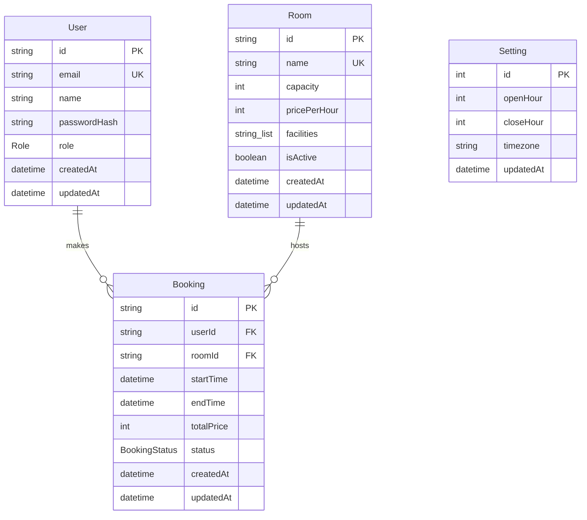

# Loka

A room booking API for studios, meeting rooms, and shared spaces. Users can browse rooms, check hourly availability, and reserve time slots. Admins manage rooms, opening hours, and every reservation.

> **Status:** complete — the backend API, the Vue frontend, Docker setup, and the seed script are all in place.

## Tech stack

| Layer | Technology |
| --- | --- |
| Runtime | Node.js 24, TypeScript |
| API | Express 5 |
| ORM | Prisma 7 (driver adapter `@prisma/adapter-pg`) |
| Database | PostgreSQL 17 (Docker) |
| Validation | Zod 4 |
| Auth | JWT (`jsonwebtoken`) + bcrypt |
| Date/time | `date-fns` + `date-fns-tz` |
| Frontend | Vue 3, Vite, TypeScript, Pinia, Vue Router, Tailwind CSS |
| Deployment | Docker, Docker Compose, Nginx |

## Features

### Implemented

- [x] JWT authentication: register, login, current user
- [x] Role-based access control (`USER`, `ADMIN`)
- [x] Room CRUD with soft delete (`isActive`)
- [x] Global operating hours + IANA timezone setting
- [x] Hourly availability slots (`AVAILABLE`, `BOOKED`, `PAST`)
- [x] Booking with server-side price calculation
- [x] Anti double-booking using a transaction + row-level lock (`409 Conflict`)
- [x] Booking history, cancellation window (2 hours), admin status updates
- [x] Zod validation middleware for `body`, `query`, and `params`
- [x] Consistent JSON error responses
- [x] PostgreSQL 17 via Docker Compose
- [x] Vue 3 + Vite + TypeScript frontend with Tailwind CSS
- [x] Pinia auth store with a persisted JWT session
- [x] Login and registration pages
- [x] Room list with capacity, hourly price, and facilities
- [x] Room detail with date picker and hourly slot grid
- [x] Multi-slot selection with live total price
- [x] Booking creation from the UI, with conflict feedback
- [x] Reservation history with status filters
- [x] Booking cancellation from the UI (2-hour rule enforced)
- [x] Admin dashboard: room CRUD, all bookings, status updates
- [x] Admin form for operating hours and timezone
- [x] Dockerfiles for backend and frontend, split Compose files
- [x] `prisma/seed.ts` with demo admin/user accounts and sample rooms

## Project structure

```
loka/
├── backend/
│   ├── prisma/
│   │   ├── schema.prisma
│   │   ├── seed.ts                # demo users, rooms, settings
│   │   └── migrations/
│   ├── src/
│   │   ├── config/env.ts          # validated environment variables
│   │   ├── lib/                   # prisma, jwt, errors, time helpers
│   │   ├── middlewares/           # auth, validation, error handling
│   │   ├── modules/
│   │   │   ├── auth/
│   │   │   ├── rooms/
│   │   │   ├── settings/
│   │   │   ├── availability/
│   │   │   └── bookings/
│   │   ├── types/express.d.ts
│   │   ├── app.ts
│   │   └── server.ts
│   ├── Dockerfile
│   ├── docker-compose.yml         # db + backend
│   ├── prisma.config.ts
│   └── .env.example
├── frontend/
│   ├── src/
│   │   ├── components/            # navbar, status badge
│   │   ├── lib/api.ts             # axios client + interceptors
│   │   ├── lib/format.ts          # currency and timezone formatting
│   │   ├── router/
│   │   ├── stores/auth.ts         # Pinia session store
│   │   ├── types/
│   │   ├── views/                 # home, auth, rooms, room detail, my bookings
│   │   ├── views/admin/           # dashboard, rooms, bookings, settings
│   │   ├── App.vue
│   │   ├── main.ts
│   │   └── style.css
│   ├── Dockerfile
│   ├── docker-compose.yml         # frontend (Nginx)
│   ├── nginx.conf                 # static hosting + /api proxy
│   ├── vite.config.ts
│   └── .env.example
└── .gitignore
```

## Prerequisites

- Node.js 24+
- pnpm 10+
- Docker + Docker Compose

## Quick start

Two ways to run Loka: the whole stack in Docker, or the API and frontend locally for development.

### Option A — Docker Compose (full stack)

The Docker setup is split per app:

| File | Services | Build context |
| --- | --- | --- |
| `backend/docker-compose.yml` | `db` (PostgreSQL) + `backend` (API) | `backend/` |
| `frontend/docker-compose.yml` | `frontend` (SPA served by Nginx) | `frontend/` |

The frontend joins the shared `loka_net` network that the backend stack creates, so **start the backend first**:

```bash
# 1. API + database
cd backend
docker compose up -d --build

# 2. Frontend (in another terminal)
cd frontend
docker compose up -d --build
```

Then open **http://localhost:8080**.

| Service | URL | Notes |
| --- | --- | --- |
| Frontend | http://localhost:8080 | Nginx serves the built SPA and proxies `/api` |
| Backend | http://localhost:4000 | Also reachable directly for debugging |
| PostgreSQL | `127.0.0.1:5432` | Data lives in the `postgresql_17_pgdata` volume |

Migrations run automatically when the backend container starts. The database is not seeded automatically; run it once:

```bash
cd backend
docker compose exec backend pnpm db:seed
```

Compose reads `backend/.env` for the API stack. `POSTGRES_DB`, `POSTGRES_USER`, `POSTGRES_PASSWORD`, `JWT_SECRET`, and `CORS_ORIGIN` are all **required** — there are no secrets or credentials baked into the compose file, so it refuses to start when one is missing:

```text
required variable POSTGRES_DB is missing a value: Set POSTGRES_DB in backend/.env
```

To stop everything, run `docker compose down` in `frontend/` first, then in `backend/`. The data volume is kept.

If a container named `loka_db` is already running from an older setup, remove it first (`docker rm -f loka_db`); the volume survives.

#### Building, tagging, and pushing images

Both compose files declare a GitHub Container Registry image and accept a `TAG` variable:

| File | Image |
| --- | --- |
| `backend/docker-compose.yml` | `ghcr.io/potasticmaeve/loka-backend:${TAG:-v1.0.0}` |
| `frontend/docker-compose.yml` | `ghcr.io/potasticmaeve/loka-frontend:${TAG:-v1.0.0}` |

```bash
# Backend image (also defines the database service)
cd backend
docker compose build backend

# Frontend image only — no database or backend required
cd frontend
docker compose build
```

Images default to `v1.0.0`; pass `TAG=x.y.z` to override. `postgres:17-alpine` is an official upstream image, so it is used directly and is not mirrored to ghcr.

Push to the registry (needs a token with `write:packages`):

```bash
docker login ghcr.io

docker push ghcr.io/potasticmaeve/loka-backend:v1.0.0
docker push ghcr.io/potasticmaeve/loka-frontend:v1.0.0
```

On a deployment host, pull instead of building:

```bash
cd backend  && docker compose pull && docker compose up -d
cd frontend && docker compose pull && docker compose up -d
```

Because each app owns its compose file, the frontend image can be built and pushed in a pipeline that never touches the backend.

### Option B — Local development

#### 1. Start PostgreSQL

```bash
cd backend
docker compose up -d db
```

This starts a container named `loka_db` with:
- database: `loka_db`
- user: `felicia`
- password: `loka_app_pass`
- port: `127.0.0.1:5432`

#### 2. Configure the backend

```bash
cp .env.example .env
```

The template ships with empty values on purpose. Fill in `DATABASE_URL` and `JWT_SECRET`; the secret must be at least 32 characters.

#### 3. Install, migrate, and run

```bash
pnpm install
pnpm db:migrate        # applies migrations and generates the Prisma client
pnpm db:seed           # demo users, rooms, and settings
pnpm dev               # http://localhost:4000
```

Check that everything is alive:

```bash
curl http://localhost:4000/api/health
# {"status":"ok","db":"connected","timestamp":"..."}
```

#### 4. Run the frontend

In a second terminal:

```bash
cd frontend
cp .env.example .env
pnpm install
pnpm dev               # http://localhost:5173
```

In development the frontend calls `/api` and Vite proxies it to `http://localhost:4000` (see `vite.config.ts`), so CORS is not involved. When the API lives on another host, set `VITE_API_URL` to its full URL.

### Demo accounts

`prisma/seed.ts` creates these accounts and rooms:

| Email | Password | Role |
| --- | --- | --- |
| `admin@loka.test` | `Admin12345` | `ADMIN` |
| `user@loka.test` | `User12345` | `USER` |

Rooms: **Studio A** (6 people, Rp75,000/hour), **Meeting Room** (12, Rp120,000/hour), **Rooftop Deck** (20, Rp150,000/hour). The seed is idempotent, so running it again will not duplicate rows.

## Environment variables

Backend variables (in `backend/.env`):

| Variable | Required | Default | Description |
| --- | --- | --- | --- |
| `DATABASE_URL` | yes | — | PostgreSQL connection string |
| `JWT_SECRET` | yes | — | Signing secret, at least 32 characters (also used by Compose) |
| `PORT` | no | `4000` | HTTP port |
| `NODE_ENV` | no | `development` | `development`, `test`, or `production` |
| `CORS_ORIGIN` | yes (Compose) | `http://localhost:5173` | Allowed frontend origin. Compose requires it (`http://localhost:8080`); local dev falls back to the Vite URL |
| `POSTGRES_DB` | yes (Compose) | — | Database name used by the Compose `db` service |
| `POSTGRES_USER` | yes (Compose) | — | Database user used by the Compose `db` service |
| `POSTGRES_PASSWORD` | yes (Compose) | — | Database password used by the Compose `db` service |
| `TAG` | no | `v1.0.0` | Image tag for the `ghcr.io` images |

The compose file contains **no default credentials**. `POSTGRES_*`, `JWT_SECRET`, and `CORS_ORIGIN` use `${VAR:?message}`, so `docker compose` fails immediately with a clear message instead of silently falling back to a hardcoded password. Add `--env-file /dev/null` to `docker compose config` to verify the guards.

Frontend variables (in `frontend/.env`):

| Variable | Required | Default | Description |
| --- | --- | --- | --- |
| `VITE_API_URL` | no | `/api` | Backend API base URL. `/api` goes through the Vite dev proxy or the Nginx proxy in Docker |

Environment variables are validated at startup in `src/config/env.ts`. The app refuses to start if something is missing or invalid.

## Database

### ERD



### Enums

- `Role`: `USER`, `ADMIN`
- `BookingStatus`: `CONFIRMED`, `CANCELLED`, `COMPLETED`

### Migrations

```bash
pnpm db:migrate      # create + apply a migration in development
pnpm db:deploy       # apply existing migrations (production/CI)
pnpm db:generate     # regenerate the Prisma client
pnpm db:studio       # open Prisma Studio at http://localhost:5555
```

### Seed data and the first admin

`pnpm db:seed` creates the demo accounts listed in [Demo accounts](#demo-accounts), including an `ADMIN` user. Registration through the API always creates a `USER` role.

To promote any other account, update the row directly:

```bash
docker exec loka_db psql -U felicia -d loka_db \
  -c "UPDATE \"User\" SET role = 'ADMIN' WHERE email = 'you@example.com';"
```

Log in again afterwards: the role is embedded in the JWT, so old tokens still say `USER`.

## API reference

Base URL: `http://localhost:4000/api`

Protected endpoints expect:

```
Authorization: Bearer <token>
```

### Health

| Method | Path | Access |
| --- | --- | --- |
| GET | `/api/health` | Public |

### Auth

| Method | Path | Access | Body |
| --- | --- | --- | --- |
| POST | `/api/auth/register` | Public | `{ "email", "name", "password" }` |
| POST | `/api/auth/login` | Public | `{ "email", "password" }` |
| GET | `/api/auth/me` | User | — |

```bash
curl -X POST http://localhost:4000/api/auth/register \
  -H "Content-Type: application/json" \
  -d '{"email":"user@loka.test","name":"Demo User","password":"password123"}'
```

### Rooms

| Method | Path | Access | Description |
| --- | --- | --- | --- |
| GET | `/api/rooms` | Public | Active rooms only |
| GET | `/api/rooms/:id` | Public | Room detail |
| GET | `/api/rooms/all` | Admin | All rooms, including inactive |
| POST | `/api/rooms` | Admin | Create a room |
| PATCH | `/api/rooms/:id` | Admin | Update fields |
| DELETE | `/api/rooms/:id` | Admin | Soft delete (`isActive = false`) |

Create body:

```json
{
  "name": "Studio A",
  "capacity": 6,
  "pricePerHour": 75000,
  "facilities": ["TV", "Whiteboard", "AC"]
}
```

### Settings

| Method | Path | Access | Description |
| --- | --- | --- | --- |
| GET | `/api/settings` | Public | Current operating hours |
| PUT | `/api/settings` | Admin | Replace operating hours |

```json
{
  "openHour": 9,
  "closeHour": 21,
  "timezone": "Asia/Jakarta"
}
```

`closeHour` must be greater than `openHour`. `timezone` must be a valid IANA timezone.

### Availability

| Method | Path | Access |
| --- | --- | --- |
| GET | `/api/rooms/:id/availability?date=YYYY-MM-DD` | Public |

Example response:

```json
{
  "room": { "id": "...", "name": "Studio A", "capacity": 6, "pricePerHour": 75000 },
  "date": "2026-11-18",
  "timezone": "Asia/Jakarta",
  "openHour": 9,
  "closeHour": 21,
  "slots": [
    {
      "hour": 9,
      "startTime": "2026-11-18T02:00:00.000Z",
      "endTime": "2026-11-18T03:00:00.000Z",
      "label": "09:00 - 10:00",
      "status": "AVAILABLE"
    }
  ]
}
```

Slot status:

- `AVAILABLE` — free and in the future
- `BOOKED` — overlaps a `CONFIRMED` booking
- `PAST` — already started (in-progress slots included)

### Bookings

| Method | Path | Access | Description |
| --- | --- | --- | --- |
| POST | `/api/bookings` | User | Create a booking |
| GET | `/api/bookings/me` | User | Own bookings (`?status=` optional) |
| GET | `/api/bookings/:id` | Owner / Admin | Booking detail |
| GET | `/api/bookings` | Admin | All bookings (`?status=` optional) |
| PATCH | `/api/bookings/:id/cancel` | Owner / Admin | Cancel a booking |
| PATCH | `/api/bookings/:id/status` | Admin | Mark `CANCELLED` or `COMPLETED` |

Create body (ISO 8601 datetimes):

```json
{
  "roomId": "cm...",
  "startTime": "2026-11-18T02:00:00.000Z",
  "endTime": "2026-11-18T04:00:00.000Z"
}
```

The server calculates `totalPrice = hours × room.pricePerHour`. The client never sends a price.

Booking rules:

- minimum 1 hour, whole-hour increments
- must start and end on a full hour in the configured timezone
- must be inside operating hours (same local day)
- `startTime` must be in the future
- user cancellations need at least 2 hours of notice; admins can force-cancel
- status transitions are forward-only: `CONFIRMED → CANCELLED | COMPLETED`

### Error format

Every error uses the same shape:

```json
{
  "error": {
    "code": "BOOKING_CONFLICT",
    "message": "This time slot was just booked by someone else. Please pick another slot.",
    "details": []
  }
}
```

| Status | Meaning |
| --- | --- |
| `400` | Invalid input (`VALIDATION_ERROR`, `INVALID_SLOT`, `OUTSIDE_OPERATING_HOURS`) |
| `401` | Missing or invalid token |
| `403` | Wrong role or not the owner |
| `404` | Resource not found |
| `409` | Conflict (`BOOKING_CONFLICT`, `EMAIL_TAKEN`, `ROOM_NAME_TAKEN`, `CANCEL_WINDOW_CLOSED`, `INVALID_STATUS`) |
| `500` | Unexpected server error |

## Avoiding double bookings

`POST /api/bookings` runs inside `prisma.$transaction()` and starts with a row-level lock:

```sql
SELECT id FROM "Room" WHERE id = $1 FOR UPDATE
```

Why this works:

1. Two requests for the same room cannot enter the critical section together. The second waits for the first transaction to finish.
2. After acquiring the lock, the service checks for overlapping `CONFIRMED` bookings:
   ```sql
   startTime < newEnd AND endTime > newStart
   ```
3. If a conflict exists, the API returns `409 BOOKING_CONFLICT`. Otherwise the booking is inserted and committed.

Without the lock, both requests could read "no conflict" before either insert, producing two overlapping bookings.

## Timezone handling

- All datetimes are stored as UTC (`timestamptz`) in PostgreSQL.
- Opening hours (`openHour`, `closeHour`) are wall-clock times in `Setting.timezone` (default `Asia/Jakarta`).
- Availability converts local slot boundaries to UTC with `date-fns-tz`.
- API responses include both ISO UTC timestamps and a human-readable `label` in local time.

## Scripts

Run from `backend/`:

| Script | Description |
| --- | --- |
| `pnpm dev` | Start with hot reload (`tsx watch`) |
| `pnpm build` | Compile TypeScript to `dist/` |
| `pnpm start` | Run the compiled build |
| `pnpm db:migrate` | `prisma migrate dev` |
| `pnpm db:deploy` | `prisma migrate deploy` |
| `pnpm db:generate` | `prisma generate` |
| `pnpm db:seed` | Insert demo users, rooms, and settings (idempotent) |
| `pnpm db:studio` | Open Prisma Studio |

Run from `frontend/`:

| Script | Description |
| --- | --- |
| `pnpm dev` | Start the Vite dev server |
| `pnpm build` | Type-check with `vue-tsc` and build for production |
| `pnpm preview` | Preview the production build |

Docker commands:

| Where | Command | Description |
| --- | --- | --- |
| `backend/` | `docker compose up -d --build` | Start db + API |
| `backend/` | `docker compose up -d db` | Start only PostgreSQL for local development |
| `backend/` | `docker compose exec backend pnpm db:seed` | Seed the Docker database |
| `frontend/` | `docker compose up -d --build` | Start the frontend on port 8080 |
| `frontend/` | `TAG=v1.0.0 docker compose build` | Build and tag the frontend image |
| `frontend/` | `docker compose down` | Stop the frontend |
| `backend/` | `docker compose down` | Stop db + API (the data volume is kept) |

## Roadmap

All planned phases are complete:

1. ~~Backend API, database schema, and authentication~~
2. ~~Vue frontend foundation with auth UI~~
3. ~~Room browsing and hourly booking~~
4. ~~Reservation history and admin dashboard~~
5. ~~Docker setup, Nginx, seed script~~

Ideas for later: email notifications, payment integration, room photos, and recurring bookings.
